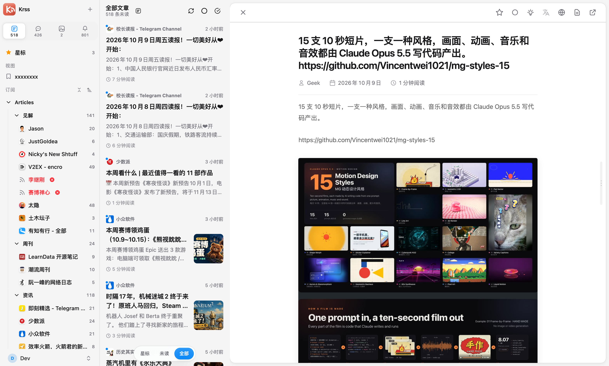
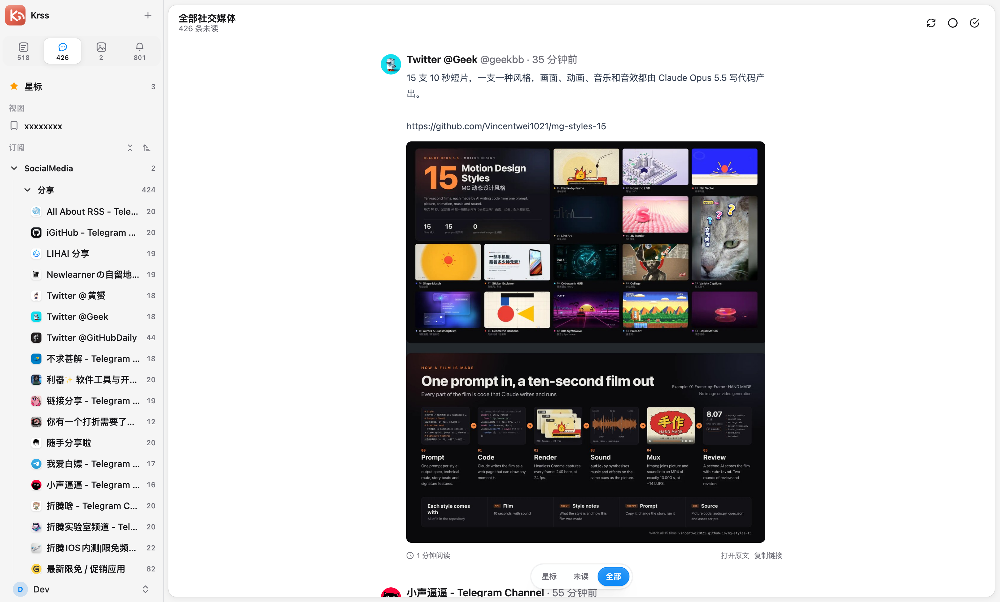
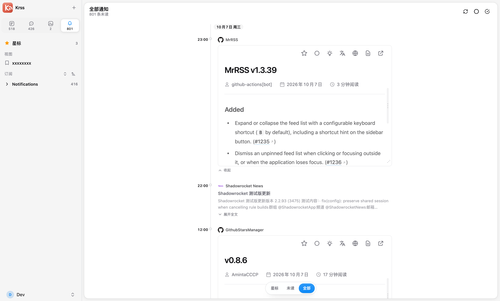
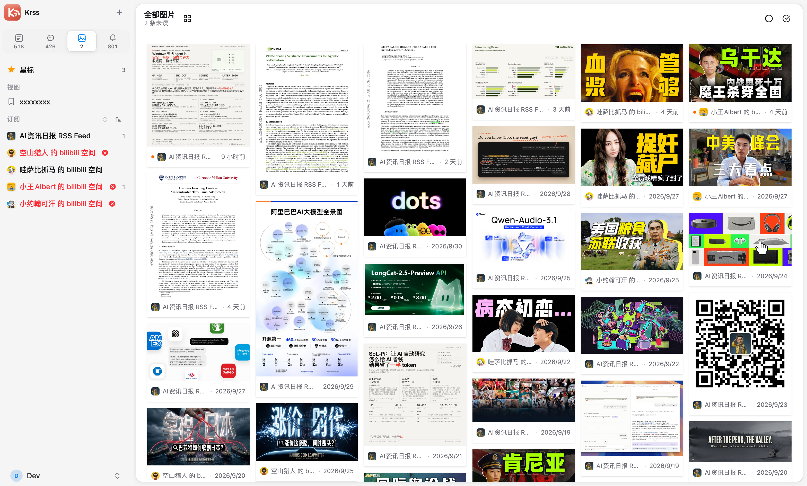
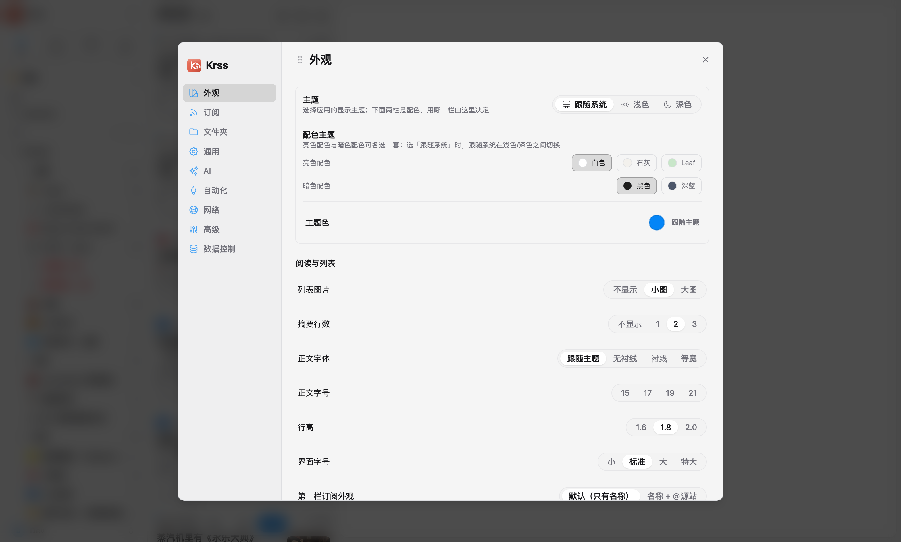
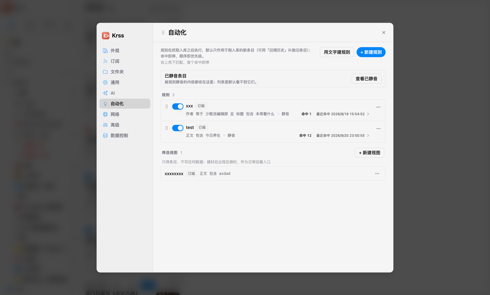

# Krss

[](https://www.gnu.org/licenses/old-licenses/gpl-2.0.en.html)
[](https://github.com/kue02/Krss/actions/workflows/docker-build.yml)

功能完整的自托管 RSS 阅读器：单二进制 + SQLite，开箱即用。内置 AI 摘要与翻译、自动化规则引擎、社交 / 通知 / 图片多视图，并支持 MCP 双向集成。

## 截图



| 社交媒体视图 | 通知视图 |
| :---: | :---: |
|  |  |

| 图片视图 | 设置 · 外观 |
| :---: | :---: |
|  |  |



## 功能特性

### 订阅与阅读

- 支持 RSS 2.0 / Atom / JSON Feed
- OPML 导入与导出（导入带进度、可取消）
- 文件夹分层管理、拖拽排序；订阅可设置内容类型与图标
- 未读 / 星标视图，未读角标可自定义，全文搜索
- 阅读模式（自动提取正文），图集灯箱，图片代理（解决防盗链）
- 站点反爬（Anubis 类）Cookie 配置
- 定时刷新（间隔可配）、手动刷新与刷新报告

### AI 能力（自备 API Key）

- 文章摘要、单篇翻译与批量翻译
- 支持 OpenAI、Anthropic 及兼容接口，可拉取模型列表并测试连通

### 自动化规则引擎

- 条件：标题 / 正文 / 作者的关键词或正则匹配，也支持 AI 相关性判断
- 支持用自然语言描述需求，自动生成规则
- 动作：星标、标已读 / 未读、静音 / 取消静音、只看该来源、自动翻译 / 自动摘要标记、webhook 推送、Bark 兼容通知推送
- 规则可预览命中条目、可作用于历史条目、可撤销（恢复被规则静音的条目）

### 多视图

- 文章视图：三栏布局（订阅 / 列表 / 正文），卡片列表 + 浮层阅读面板
- 社交媒体视图：Twitter/X 风格卡片 + 图片网格，时间线里可直接展开成完整阅读器
- 通知视图：推送时间线，展开即完整正文页（工具栏、大纲、AI 摘要、翻译全可用）
- 图片视图：网格 / 悬停大图 / 照片墙三种排布

### 集成

- 内置 MCP 服务器（streamable-http，`/mcp`，长期 token 鉴权）：Claude 等外部 AI 客户端可直接读取条目
- 可把外部 MCP 服务器作为订阅源接入
- RSSHub 地址与 Access Key 配置
- 代理：可按订阅 / 文件夹单独覆盖，密码字段掩码显示

### 界面与体验

- 5 套主题（3 浅 2 深）与跟随系统；主题色、圆角、列表密度、正文字体 / 字号 / 行高可调
- 键盘快捷键：`j` `k` 上下条、`m` 已读/未读、`s` 星标、`v` 原文、`r` 刷新、`f` 搜索、`?` 帮助（以设置 → 快捷键中的完整列表为准）
- PWA，可安装到桌面与移动设备
- 全部设置服务端持久化，换设备登录依然一致
- 界面语言：简体中文 / English

## 快速开始

### Docker Compose（推荐）

```bash
curl -O https://raw.githubusercontent.com/kue02/Krss/main/docker-compose.yml
docker compose up -d
```

或手动创建 `docker-compose.yml`：

```yaml
services:
  krss:
    image: ghcr.io/kue02/krss:latest
    container_name: krss
    ports:
      - "8090:8090"
    volumes:
      - ./data:/app/data
    environment:
      - KRSS_LOG_LEVEL=info
    restart: always
```

访问 `http://localhost:8090`，首次打开会引导创建账号；数据持久化在 `./data` 目录。

### Docker Run

```bash
docker run -d \
  --name krss \
  -p 8090:8090 \
  -v ./data:/app/data \
  ghcr.io/kue02/krss:latest
```

### 本地开发

前置依赖：Go 1.25+、[Bun](https://bun.sh/)

后端：

```bash
cd backend
go mod download
KRSS_ADDR=:8090 go run ./cmd/server   # http://localhost:8090，数据落在 ./data
```

前端：

```bash
cd frontend
bun install
bun run dev                            # http://localhost:5173，默认代理到 :8090
```

后端不在默认端口时用 `KRSS_DEV_BACKEND` 指定：

```bash
KRSS_DEV_BACKEND=http://localhost:8090 bun run dev
```

### 测试与质量门

```bash
# 后端
cd backend
make test                  # go test ./... -race
make lint                  # golangci-lint run

# 前端
cd frontend
bun run test               # vitest run
bunx tsc -b                # 类型检查
bun run build              # 产物输出到 dist/
```

## 配置

| 变量                | 默认值           | 说明                                          |
| ------------------- | ---------------- | --------------------------------------------- |
| `KRSS_ADDR`         | `:8090`          | 监听地址                                      |
| `KRSS_DATA_DIR`     | `./data`         | 数据目录（容器内为 `/app/data`）              |
| `KRSS_DB_PATH`      | `data/krss.db`   | SQLite 数据库文件路径                         |
| `KRSS_STATIC_DIR`   | 自动探测         | 前端静态文件目录（`frontend/dist`）           |
| `KRSS_LOG_LEVEL`    | `info`           | 日志级别：`debug` / `info` / `warn` / `error` |
| `KRSS_SWAGGER`      | `false`          | 设为 `true` 开启 `/swagger/index.html`        |
| `KRSS_ENABLE_PPROF` | `false`          | 开启 pprof 性能分析                           |
| `KRSS_PPROF_ADDR`   | `127.0.0.1:6060` | pprof 监听地址（开启后生效）                  |

## 数据与备份

- 所有数据（SQLite 数据库、缓存、日志）都在数据目录（默认 `./data`，容器内 `/app/data`），备份该目录即可完整迁移。
- 升级：`docker compose pull && docker compose up -d`。升级后服务启动时可能自动回填订阅图标等缓存，属正常现象。
- 版本说明见 [docs/releases/](docs/releases/)。

## 目录结构

```
backend/            Go 后端：API、SQLite、抓取与解析、规则引擎、MCP
frontend/           React + Vite 前端
docker/             Dockerfile 与 entrypoint
.github/workflows/  CI：后端测试、前端测试、镜像构建、发布
docker-compose.yml  一键部署
```

## 致谢

- 本项目基于 [Gist](https://github.com/9bingyin/Gist) 改造
- 界面与交互参照 [Nextflux](https://github.com/electh/nextflux) 与 [Folo](https://github.com/RSSNext/Folo)

## 许可证

[GPL-2.0](./LICENSE)
