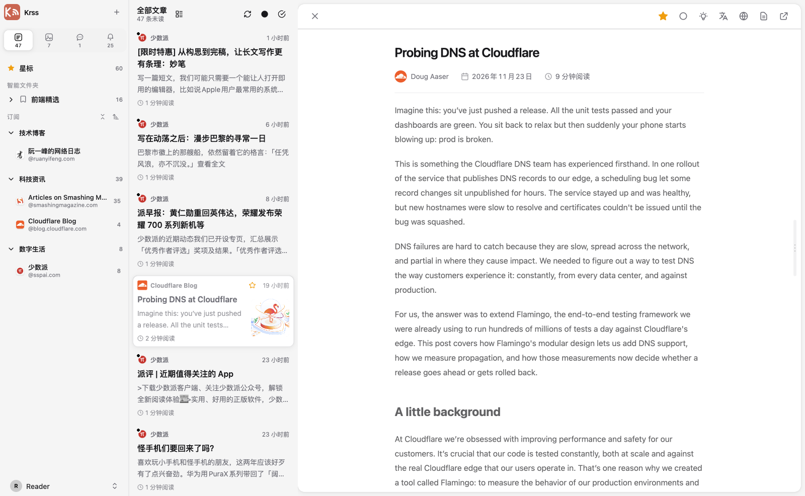
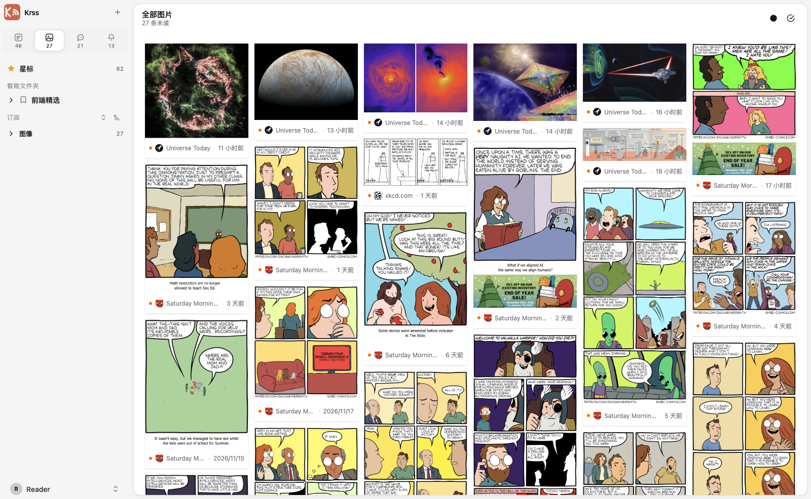
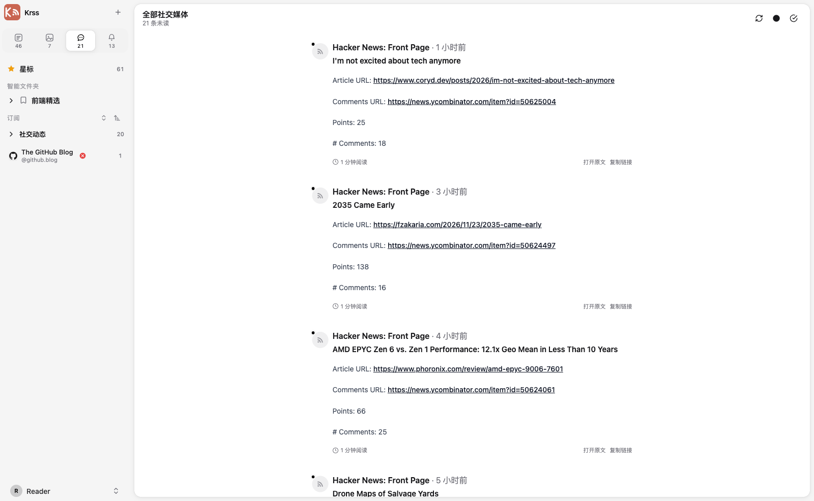
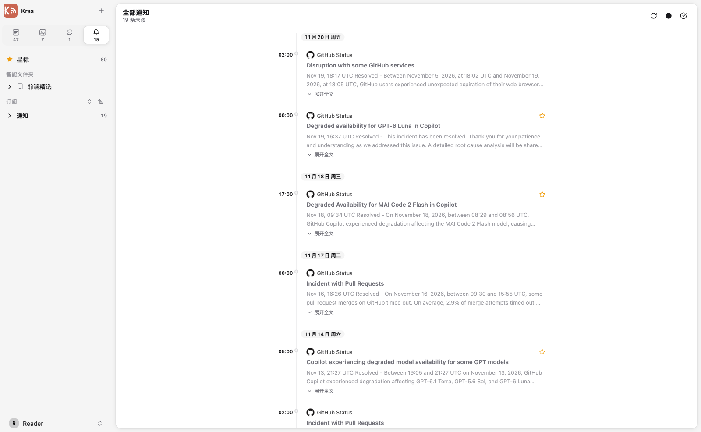
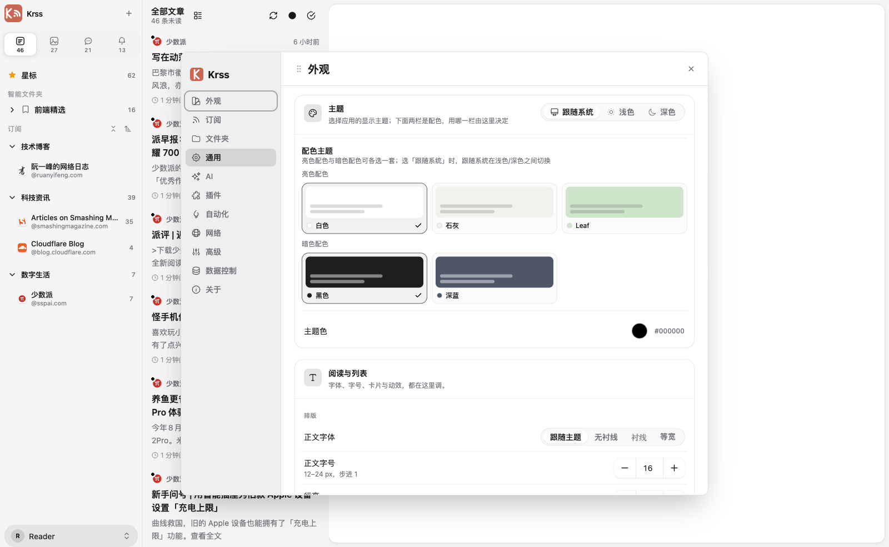
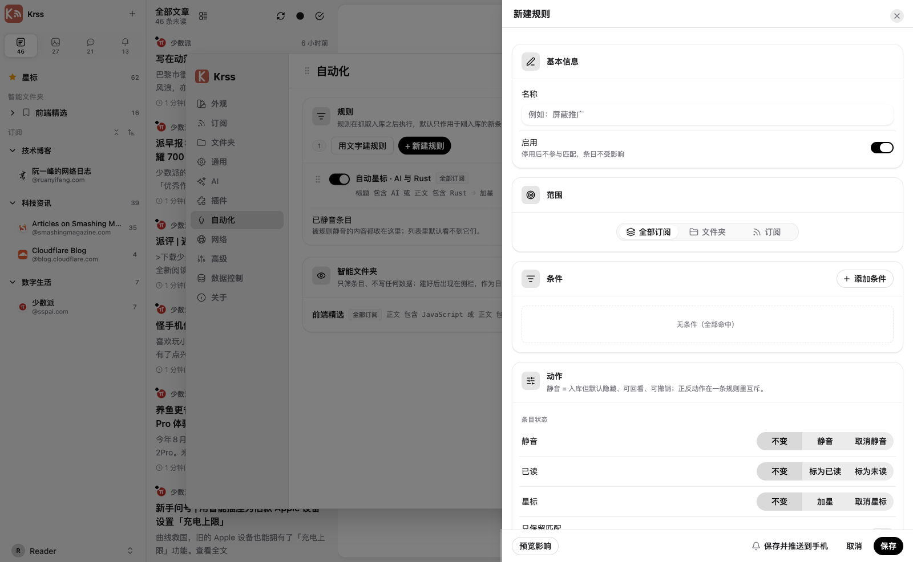
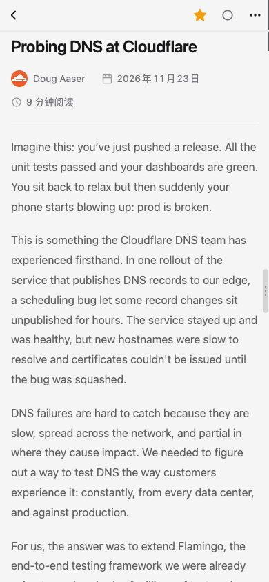
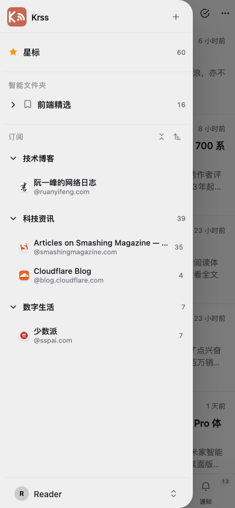

# Krss

[](https://www.gnu.org/licenses/old-licenses/gpl-2.0.en.html)
[](https://github.com/kue02/Krss/actions/workflows/docker-build.yml)
[](https://github.com/kue02/Krss/releases)

一个跑在自己服务器上的 RSS 阅读器：单个二进制 + SQLite，一条命令即可启动。订阅、已读、星标和规则数据都在自己手里；界面参照 Folo 的文章 / 社交 / 通知 / 图片四视图形态，并内置插件系统、自动化规则、AI 摘要与翻译、双向 MCP 集成。

> 截图均取自全新实例，订阅公开示例源（Cloudflare Blog、GitHub Blog、阮一峰的网络日志、少数派、Smashing Magazine、Hacker News、Universe Today、xkcd、Saturday Morning Breakfast Cereal、GitHub Status）仅作演示。

## 它和别的阅读器不一样的地方

- **插件系统**：zip 安装，能加菜单、工具栏和独立视图，也能给自动化提供动作；Bark 推送、RSSHub 适配、GitHub 头像都是插件。
- **自动化规则**：范围 + 关键词 / 正则 / AI 相关性，一句话生成规则；可预览命中、回溯历史、撤销、看命中日志。
- **筛选视图**：一套条件存成侧栏入口，只筛不改数据，随时点开。
- **双向 MCP**：把外部 MCP 服务当订阅源；Krss 自己也能作为 MCP 服务器，让 Claude 等客户端直接读取条目。
- **智能代理**：直连不通自动走代理，按域名记住结论；订阅 / 文件夹可单独覆盖。
- **RSSHub**：填地址 + Access Key 订阅微博 / B 站 / Telegram，图标反解真实站点，失败原因说人话。
- **Folo 式多形态**：文章 / 社交 / 通知 / 图片四视图，每个源可单独指定类型。
- **移动端**：底部四轨导航、长按操作、正文目录、PWA；另附 iOS 壳源码。
- **翻译 / 摘要**：列表卡片直接显示译文，4 条免费翻译通道可轮换，全部失败再自动切回模型；按段翻译保留格式。
- **图片 / 反爬**：图片代理 + 缓存解决防盗链；Anubis 类站点可填 Cookie。

## 截图



**文章视图**：左侧订阅、中间列表、右侧正文；工具栏含 AI 摘要、翻译与打开原文，长文带右侧目录大纲。

| 图片视图 | 社交媒体视图 |
| :---: | :---: |
|  |  |
| 图片视图：照片墙，悬停 / 灯箱看大图 | 社交媒体视图：时间线里直接展开完整阅读器 |

| 通知视图 | 外观设置 |
| :---: | :---: |
|  |  |
| 通知视图：按日期分组，展开即完整正文 | 外观设置：5 套主题、配色、正文字体字号与列表密度 |



**自动化 · 新建规则**：范围 + 条件 + 动作三段式，可预览影响、保存并推送到手机，也能用一句话生成规则。

移动端（底部四轨导航 · 正文阅读 · 侧边栏）：

| 文章列表 | 正文阅读 | 侧边栏 |
| :---: | :---: | :---: |
|  |  |  |
| 底部四轨 + 未读角标 | 正文目录、AI 摘要、翻译 | 文件夹与智能视图 |

## 功能特性

### 订阅与阅读

- 支持 RSS 2.0 / Atom / JSON Feed
- OPML 导入与导出（导入带进度、可取消）
- 文件夹分层管理；分类可在设置里拖拽排序或隐藏，侧边栏同步；每个订阅可设置内容类型与图标
- 未读 / 星标视图，未读角标样式可自定义，全文搜索
- 阅读模式（自动提取正文），图集灯箱，图片代理（解决防盗链）
- 站点反爬（Anubis 类）Cookie 配置
- 定时刷新（间隔可配）、手动刷新与刷新报告

### AI 摘要与翻译（自备 API Key，不配也能翻译）

- 文章摘要、单篇翻译与批量翻译，列表卡片可直接显示译文
- 支持 OpenAI、Anthropic 及兼容接口，可拉取模型列表并测试连通
- 4 条内置免费翻译通道（Google / 有道 / 微软 / B 站），可排序轮换，全部失败后自动切回模型

### 自动化规则引擎

- 条件：标题 / 正文 / 作者的关键词或正则匹配，也支持 AI 相关性判断
- 支持用自然语言描述需求，自动生成规则
- 动作：星标、标已读 / 未读、静音 / 取消静音、只看该来源、自动翻译 / 自动摘要标记、webhook 推送、Bark 兼容通知推送
- 规则可预览命中条目、可作用于历史条目、可撤销（恢复被规则静音的条目）

### 筛选视图

- 一套条件（关键词 / 正则 / AI 相关性）存成侧栏入口，只筛不改数据
- 与自动化规则共用同一套编辑体验，随时改条件、看实时命中数

### 插件系统

- zip 安装插件，可注册菜单、工具栏、独立视图，也能给自动化提供动作
- 内置 Bark 推送、RSSHub 适配、GitHub 头像等插件，可在设置里直接开关与配置

### 多视图

- **文章视图**：三栏布局（订阅 / 列表 / 正文），卡片列表 + 浮层阅读面板
- **社交媒体视图**：Twitter/X 风格卡片 + 图片网格，时间线里可直接展开成完整阅读器
- **通知视图**：推送时间线，展开即完整正文页（工具栏、大纲、AI 摘要、翻译全可用）
- **图片视图**：网格 / 悬停大图 / 照片墙三种排布
- 每个订阅可单独指定属于哪种视图，四种形态自由组合

### 集成

- 内置 MCP 服务器（streamable-http，`/mcp`，长期 token 鉴权）：Claude 等外部 AI 客户端可直接读取条目
- 可把外部 MCP 服务器作为订阅源接入
- RSSHub 地址与 Access Key 配置，图标反解真实站点
- 代理：可按订阅 / 文件夹单独覆盖，密码字段掩码显示；直连失败自动走代理并按域名记住结论

### 界面与体验

- 5 套主题（3 套浅色、2 套深色）并支持跟随系统；主题色、圆角、列表密度、正文字体 / 字号 / 行高可调
- 键盘快捷键：`j` `k` 上下条、`m` 已读 / 未读、`s` 星标、`v` 原文、`r` 刷新、`f` 搜索、`?` 帮助（以「设置 → 快捷键」中的完整列表为准）
- PWA，可安装到桌面与移动设备；移动端底部四轨导航、长按操作、正文目录
- 全部设置服务端持久化，换设备登录依然一致
- 界面语言：简体中文 / English

## 快速开始

### Docker Compose（推荐）

```bash
curl -O https://raw.githubusercontent.com/kue02/Krss/main/docker-compose.yml
docker compose up -d
```

或手动创建 `docker-compose.yml`：

```yaml
services:
  krss:
    image: ghcr.io/kue02/krss:latest
    container_name: krss
    ports:
      - "8090:8090"
    volumes:
      - ./data:/app/data
    environment:
      - KRSS_LOG_LEVEL=info
    restart: always
```

访问 `http://localhost:8090`，首次打开会引导创建账号；数据持久化在 `./data` 目录。

### Docker Run

```bash
docker run -d \\
  --name krss \\
  -p 8090:8090 \\
  -v ./data:/app/data \\
  ghcr.io/kue02/krss:latest
```

### 本地开发

前置依赖：Go 1.25+、[Bun](https://bun.sh/)

后端：

```bash
cd backend
go mod download
KRSS_ADDR=:8090 go run ./cmd/server   # http://localhost:8090，数据落在 ./data
```

前端：

```bash
cd frontend
bun install
bun run dev                            # http://localhost:5173，默认代理到 :8090
```

后端不在默认端口时用 `KRSS_DEV_BACKEND` 指定：

```bash
KRSS_DEV_BACKEND=http://localhost:8090 bun run dev
```

### 测试与质量门

```bash
# 后端
cd backend
make test                  # go test ./... -race
make lint                  # golangci-lint run

# 前端
cd frontend
bun run test               # vitest run
bunx tsc -b                # 类型检查
bun run build              # 产物输出到 dist/
```

## 配置

除下列环境变量外，绝大部分选项都可以在应用内的「设置」中调整并服务端持久化。

| 变量                  | 默认值           | 说明                                              |
| --------------------- | ---------------- | ------------------------------------------------- |
| `KRSS_ADDR`           | `:8090`          | 监听地址                                          |
| `KRSS_DATA_DIR`       | `./data`         | 数据目录（容器内为 `/app/data`）                  |
| `KRSS_DB_PATH`        | `data/krss.db`   | SQLite 数据库文件路径                             |
| `KRSS_STATIC_DIR`     | 自动探测         | 前端静态文件目录（`frontend/dist`）               |
| `KRSS_LOG_LEVEL`      | `info`           | 日志级别：`debug` / `info` / `warn` / `error`     |
| `KRSS_MEDIA_CACHE_MB` | `512`            | 代理媒体缓存上限（MB），缓存在数据目录下          |
| `KRSS_CORS_ORIGINS`   | 见下             | 追加允许的跨域来源，逗号分隔                      |
| `KRSS_SWAGGER`        | `false`          | 设为 `true` 开启 `/swagger/index.html`            |
| `KRSS_ENABLE_PPROF`   | `false`          | 开启 pprof 性能分析                               |
| `KRSS_PPROF_ADDR`     | `127.0.0.1:6060` | pprof 监听地址（开启后生效）                      |

`KRSS_CORS_ORIGINS` 会在内置的默认来源（桌面 / 移动客户端的 `mygo://localhost`、`https://mygo.localhost`、`null`）之外追加来源，方便换域名时无需改代码。

## 数据与备份

- 所有数据（SQLite 数据库、缓存、日志）都在数据目录（默认 `./data`，容器内 `/app/data`），备份该目录即可完整迁移。
- 升级：`docker compose pull && docker compose up -d`。升级后服务启动时可能自动回填订阅图标等缓存，属正常现象。
- 版本说明见 [docs/releases/](docs/releases/)，完整变更记录见 [CHANGELOG.md](CHANGELOG.md)。
- 自己写插件：从 [docs/plugins/](docs/plugins/) 开始（清单、Go API、外部进程协议、沙箱 bridge）。

## 目录结构

```
backend/            Go 后端：API、SQLite、抓取与解析、规则引擎、MCP
frontend/           React + Vite 前端
docker/             Dockerfile 与 entrypoint
.github/workflows/  CI：后端测试、前端测试、镜像构建、发布
docker-compose.yml  一键部署
```

## 致谢

- 本项目基于 [Gist](https://github.com/9bingyin/Gist) 改造
- 界面与交互参照 [Nextflux](https://github.com/electh/nextflux) 与 [Folo](https://github.com/RSSNext/Folo)

## 许可证

[GPL-2.0](./LICENSE)
